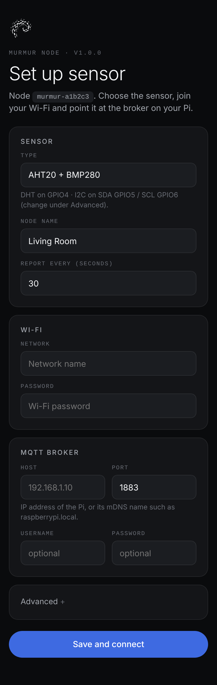

<p align="center">
  <picture>
    <source media="(prefers-color-scheme: dark)" srcset="docs/logo-dark.svg">
    
  </picture>
</p>

<h1 align="center">murmur-node</h1>

<p align="center">ESP32-C3 SuperMini firmware that turns a cheap sensor into one bird in the flock.<br>
Pick the sensor, enter your Wi-Fi and broker, and it starts reporting.</p>

Each node reads temperature, humidity and/or pressure and publishes it over MQTT to
**[murmur-core](https://github.com/alexcyterski/murmur-core)**, which stores the history and draws the dashboard.
Every node names itself after its MAC address, so you can add as many as you like.

## Wiring

| Sensor | Connection |
|---|---|
| DHT22, DHT11 | DATA → **GPIO4**, VCC → 3V3, GND → GND (10 kΩ pull-up to 3V3 if your module lacks one) |
| AHT20 + BMP280, AHT20, BMP280, BME280 | SDA → **GPIO5**, SCL → **GPIO6**, VIN → 3V3, GND → GND |

You can change the pins during setup. GPIO 2, 8 (LED) and 9 (BOOT) are reserved.

## Flash and set up

```bash
git clone https://github.com/alexcyterski/murmur-node && cd murmur-node
pio run -t upload          # PlatformIO CLI, or "Upload" in VS Code
```

1. The board opens a Wi-Fi network called **`Murmur-XXXXXX`** and its LED blinks slowly.
2. Join it from your phone. If the setup page doesn't open by itself, go to `192.168.4.1`.
3. Choose the sensor (or *Auto-detect* for I²C), give the node a name, and enter your Wi-Fi and the Pi's address.
4. Save. The node reboots and appears on the murmur-core dashboard.

<p align="center"></p>

**Flashing a batch?** Copy `include/murmur_secrets.example.h` to `include/murmur_secrets.h` and fill it in.
Boards flashed with that build skip the setup page.

## On the board

| LED | Meaning |
|---|---|
| Slow blink | Setup page open |
| Fast blink | Connecting to Wi-Fi |
| Double blink | No broker or no sensor |
| Short blip | Reading sent (can be turned off from the dashboard) |

| BOOT button | Action |
|---|---|
| Press while awake | Send a reading now; in battery mode, extend maintenance by 5 minutes |
| Hold 5 s while awake | Factory reset |

- **Wi-Fi outage (always-on):** if Wi-Fi is down for 3 minutes, the setup page reopens. The node keeps retrying in the background.
- **Weak antenna:** some SuperMini boards can't connect at full power, so the node retries at reduced TX power on its own.
- **Updates over Wi-Fi:** `pio run -e ota -t upload --upload-port murmur-a1b2c3.local`

Supported sensors: DHT22/AM2302, DHT11, AHT20(+BMP280), BMP280 and BME280. Nodes speak the
[Murmur MQTT protocol](https://github.com/alexcyterski/murmur-core/blob/main/docs/protocol.md).

## Battery mode

Enable **Battery mode** in the setup portal or on the node's dashboard page (firmware 1.1.0+). Always-on remains the default. Enabling it chooses at least a 5-minute interval; disabling it restores 30 seconds. You can then adjust the interval yourself; **5–15 minutes** is a useful starting point for battery mode.

- On a timer wake, the node connects, allows 1.5 seconds for retained configuration, publishes metadata and a reading, then announces `sleeping` and deep-sleeps for the report interval. Actual spacing includes wake/connect time. The status LED is held off during sleep; sensor modules remain powered.
- Failed Wi-Fi joins return to sleep. Other unsuccessful wake cycles have an approximately 60-second budget, checked between blocking operations. Failure retries sleep for at least 5 minutes to avoid draining the battery during an outage.
- Configuration changes, including turning battery mode off, apply at the next successful wake. Identify/read/reboot commands are not queued for sleeping nodes.
- **Press RESET** (or power-cycle) for a 5-minute maintenance window for OTA and commands. Tapping BOOT while awake extends it; an OTA transfer is allowed to finish. The ESP32-C3 cannot wake from deep sleep using the SuperMini's BOOT pin (GPIO9).
- If Wi-Fi fails during that explicit maintenance window, the setup portal opens. It sleeps after 5 minutes without a connected phone instead of continually rebooting. Routine timer wakes never open the portal.

The dashboard treats sleeping nodes as healthy until reports become overdue. Readings remain best-effort MQTT telemetry without offline buffering. Battery life depends on the board's regulator, power LEDs and attached sensors; measure the assembled device's sleep current.

## Development checks

```bash
pio run
c++ -std=c++11 -Wall -Wextra -Werror tests/protocol.cpp -o /tmp/murmur-protocol-test
/tmp/murmur-protocol-test
```
